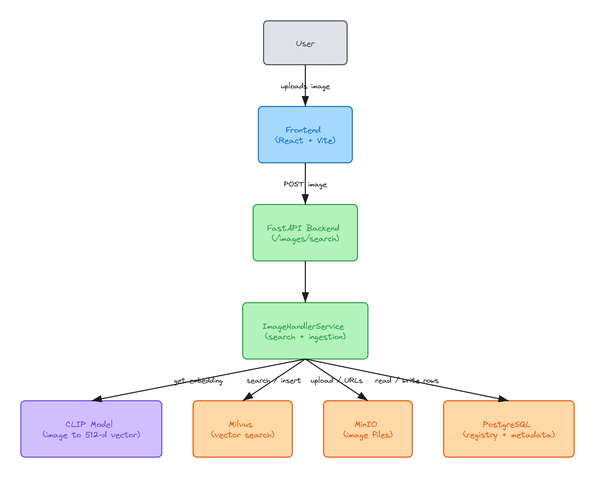

# VISTA

Visual Intelligence Search and Tracking Architecture.

Basically an image search engine. You upload a picture and it finds pictures that are similar in meaning, not just pixel matches. A beach photo should bring back other beach photos even if the colors and angles are totally different.

Under the hood it uses CLIP to turn images into vectors and Milvus to find the nearest ones.



## What it can do right now

- Image to image search
- Asks the user before saving their image. If they say no, nothing is stored
- Saved images go through an ingestion step and become searchable for the next person
- Stores some metadata per image (sha256, perceptual hash, size, width/height)
- CLIP, Milvus and MinIO are behind small interfaces, so they can be swapped out later
- Small React UI with drag and drop

## Stack

FastAPI, CLIP (HuggingFace + PyTorch), Milvus, MinIO, Postgres with SQLAlchemy, and React + Vite on the frontend. Postgres, MinIO and Milvus run through Docker Compose.

## Running it locally

You need Docker, Python 3.10+ and Node.

**Services**

```bash
cd backend
cp .env.example .env
docker-compose up -d
```

Fill in the passwords in `.env` first. MinIO needs a license file, details are in [DOCKER_SETUP.md](backend/DOCKER_SETUP.md).

A couple of things that tripped me up:
- if you run the backend on your machine (not in Docker), set the hosts in `.env` to `localhost`
- `EMBEDDING_MODEL_NAME` has to be a HuggingFace id, e.g. `openai/clip-vit-base-patch32`

**Backend**

```bash
cd backend
python -m venv venv
venv\Scripts\activate        # mac/linux: source venv/bin/activate
pip install -r requirements.txt
uvicorn app.main:app --reload
```

First run takes a bit because CLIP downloads its weights. Swagger is at http://localhost:8000/docs

**Frontend**

```bash
cd frontend
cp .env.example .env
npm install
npm run dev
```

## Trying the API

```bash
curl -X POST "http://localhost:8000/images/search?user_consent=false" -F "file=@cat.jpg"
```

You get back `{"results": [...]}` with image URLs. Set `user_consent=true` if you want the image added to the pool.

## Docs

If you want to know how it's put together:

- [HLD](backend/docs/HLD.md) - overall design
- [LLD](backend/docs/LLD.md) - code, classes, tables
- [Flows](backend/docs/FLOW.md) - search and ingestion step by step

## What's next

Not built yet, but on the list:

- text to image search ("red sports car")
- move ingestion to a background job / cron
- use the hashes to skip duplicate uploads
- proper health checks for the DBs
- filters (date, type, size)
- re-ranking
- more providers like S3, Qdrant, SigLIP
- tests, CI, maybe Kubernetes at some point

## Status

Still in progress. Search and ingestion both work end to end.

Made for learning and research.
