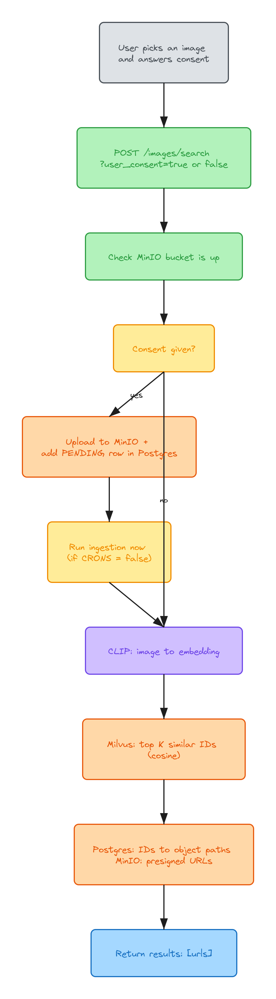
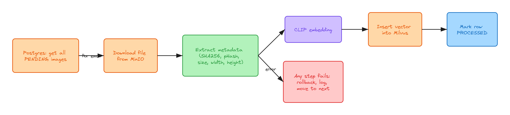

# Flows

## Search

1. User picks an image in the UI
2. A popup asks if VISTA can keep it
3. Frontend calls `POST /images/search?user_consent=true|false` with the file
4. Backend checks the MinIO bucket is reachable, errors out if not
5. If consent is yes, the image goes to MinIO, a `PENDING` row is added in Postgres, and ingestion runs right away if `CRONS=false`
6. CLIP makes the vector for the uploaded image
7. Milvus gives back the top K closest IDs
8. Postgres maps the IDs to file paths, MinIO turns those into presigned URLs
9. Backend returns the URLs and the UI shows them

When consent is no, step 5 just doesn't happen.

## Ingestion

Takes every `PENDING` image and, one at a time:

1. downloads it from MinIO
2. saves metadata (sha256, phash, size, width, height)
3. makes the CLIP vector
4. inserts it into Milvus
5. marks the row `PROCESSED`

If something fails it rolls back that one image, prints the error and moves on. The row stays `PENDING`, so it gets picked up again next time.

Right now this runs inside the search request. With `CRONS=true` the request skips it, and a scheduled job is supposed to call `ImageHandlerService.ingest_images()`. That job doesn't exist yet.

## Startup

DB gets created if missing, then the tables, then the MinIO bucket. CLIP, Milvus and MinIO clients load when the search routes are imported. CLIP downloads its weights on the very first start, so that one's slow.
