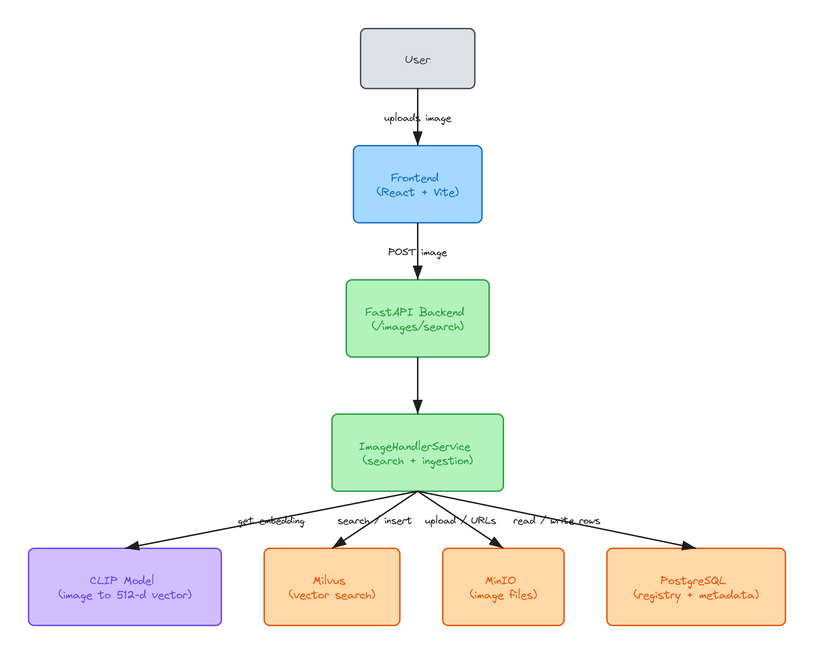

# HLD

## The idea

Every image gets turned into a vector of 512 numbers by CLIP. Images that mean similar things end up with vectors that are close to each other. So searching is just: get the vector of the uploaded image, and ask Milvus for the nearest ones.

## Pieces

**Frontend** - React app. You drop an image, it asks if we can keep it, then shows results.

**Backend** - FastAPI. Handles the upload, runs search and ingestion. CLIP runs inside this process, it's not a separate service.

**Milvus** - holds the vectors and does the nearest neighbour search (cosine).

**MinIO** - holds the actual image files. It speaks the S3 API, so moving to S3 later should be easy.

**Postgres** - keeps track of every saved image. Where the file is, whether it's been processed, hashes, size etc.

The same UUID is used in all three stores. That's how a Milvus result gets mapped back to a file.

## Search vs ingestion

Search is the part the user sees. Upload, get vector, query Milvus, turn the IDs into URLs, send them back.

Ingestion is how the pool grows. If the user says yes, we save the image and mark it `PENDING`. Ingestion picks up pending images, makes their vectors, puts them in Milvus and marks them `PROCESSED`.

For now ingestion just runs inside the search request (when `CRONS=false`). It works but it makes "yes" searches slower. Plan is to move it to a background job.

## Swapping things out

CLIP, Milvus and MinIO each sit behind a base class + a factory. Which one gets used comes from `.env`. Only one of each exists right now, but the enums already have room for OpenCLIP/SigLIP, Qdrant/FAISS/Pinecone and S3/Azure/GCS.

## Privacy

If the user says no, the image is only used for that one search. It never hits MinIO or Postgres.

## What's not great yet

- ingestion inside the request (mentioned above)
- `FAILED` status is defined but never set, so broken images just stay `PENDING` and get retried
- `/health/databases_health` always says ok, it doesn't actually check
- only image to image. CLIP can do text too, just haven't wired it up
