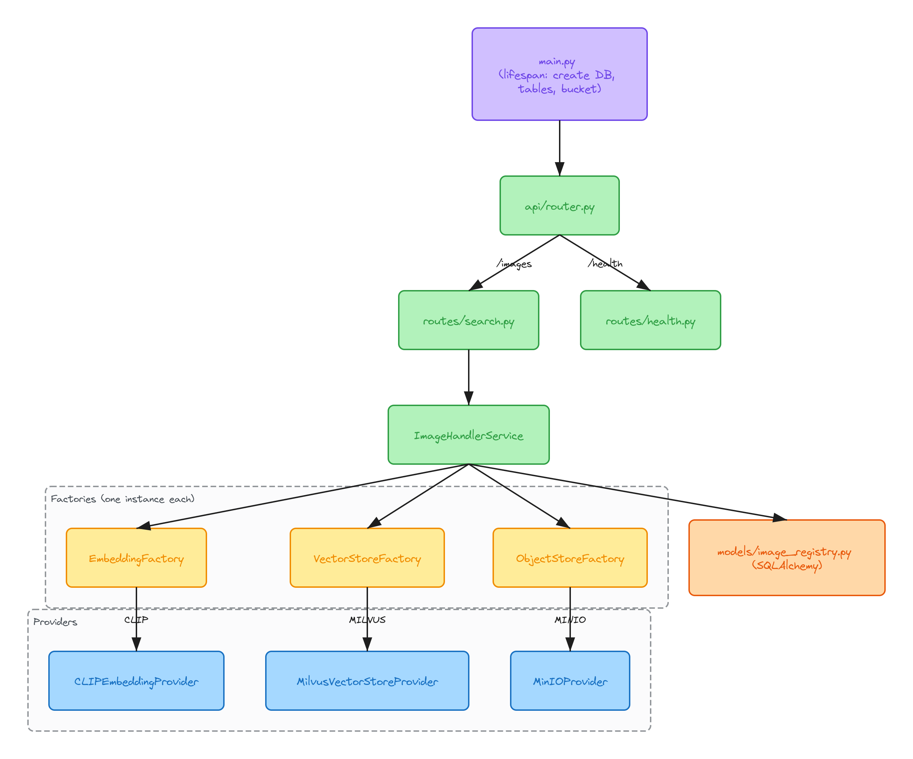
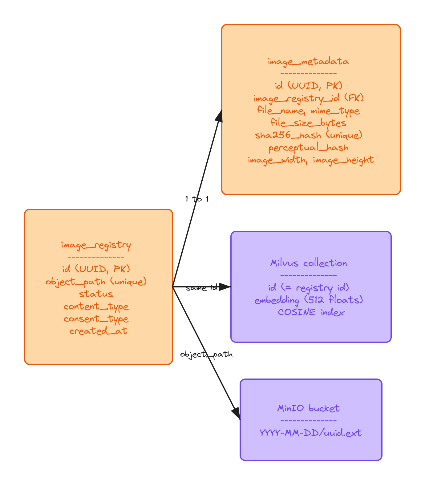

# LLD



## Code layout

```text
backend/app/
├── main.py                 # app + startup
├── api/
│   ├── router.py           # /images and /health
│   └── routes/
│       ├── search.py
│       └── health.py
├── core/                   # settings, db session, enums, exceptions
├── models/
│   └── image_registry.py   # the two tables
├── providers/
│   ├── embedding_provider/ # CLIP
│   ├── vector_stores/      # Milvus
│   └── object_storages/    # MinIO
└── services/
    └── image_handler_service.py
```

## On startup

`lifespan` in `main.py` creates the Postgres database if it's missing, runs `create_all` for the tables, and creates the MinIO bucket if needed.

The Milvus collection gets created the first time the Milvus provider is built, which happens when `routes/search.py` is imported.

## Providers

Same pattern for all three: a base class, one real implementation, and a factory that builds it once and reuses it.

- `EmbeddingFactory` gives you `CLIPEmbeddingProvider`. `get_embedding(bytes)` returns a normalized 512 float list. It runs on GPU if `EMBEDDING_DEVICE=cuda` and CUDA is there, otherwise CPU.
- `VectorStoreFactory` gives you `MilvusVectorStoreProvider`. It has `insert(id, embedding)` and `search(embedding, top_k)`, and search returns IDs with the best match first. The collection has two fields, `id` (varchar 36) and `embedding` (float vector, dim 512), with AUTOINDEX + COSINE.
- `ObjectStoreFactory` gives you `MinIOProvider`. It does upload, download and `generate_obj_url`, which returns a presigned link. Files are stored as `YYYY-MM-DD/<uuid>.<ext>`.

Adding a new provider means writing a class that extends the base, adding a `case` in the factory, and adding the value to the enum in `core/enums.py`.

## ImageHandlerService

Most of the logic lives here.

- `search(file, user_consent)` is what the route calls. If consent is true it saves the image first (and runs ingestion if `CRONS=false`), then it embeds the image, queries Milvus and returns URLs.
- `handle_user_consent` uploads to MinIO and adds a `PENDING` row.
- `ingest_images` goes through every `PENDING` row. For each one it downloads the file, saves metadata, embeds it, inserts into Milvus and sets the row to `PROCESSED`.
- `extract_and_store_metadata` computes sha256, phash, size, width and height, and writes them to `image_metadata`.
- `get_image_urls` is a helper outside the class. It takes the IDs, finds their paths in Postgres and makes presigned URLs.

## Tables



`image_registry`: one row per saved image.
- `id` UUID, primary key (same id used in Milvus)
- `object_path` path in MinIO, unique
- `status` PENDING / PROCESSED / FAILED
- `content_type`, `consent_type`, `created_at`

`image_metadata`: 1 to 1 with registry.
- `image_registry_id` FK, unique
- `file_name`, `mime_type`, `file_size_bytes`
- `sha256_hash` unique, for exact dupes
- `perceptual_hash` for near dupes
- `image_width`, `image_height`

## Endpoints

- `POST /images/search?user_consent=true|false` takes the file as multipart field `file`. Returns `{"results": [urls]}`
- `GET /images/search-test` just checks the router
- `GET /health/health`
- `GET /health/databases_health` is a placeholder for now

## Config

Everything is read from `.env` through `core/settings.py`. The ones worth knowing:

- `EMBEDDING_MODEL_NAME` - HuggingFace id, e.g. `openai/clip-vit-base-patch32`
- `EMBEDDING_DEVICE` - `cpu` or `cuda`
- `TOP_K_SEARCH_RESULTS` - default 20
- `CRONS` - false means ingestion runs right after a consented upload

`MAX_UPLOAD_SIZE_MB` and `IMAGE_INGESTION_ENABLED` are defined but nothing uses them yet.

## TODO

- ingestion writes to `/tmp/<id>`, which breaks on Windows. Should use `tempfile`
- set `FAILED` when ingestion throws
- check sha256 before saving so we don't store the same image twice
- Milvus token `root:Milvus` is hardcoded, move to `.env`
- `get_image_urls` uses an `IN` query, so the Milvus ranking order gets lost. Need to sort back by the id list
